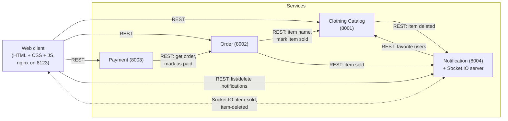
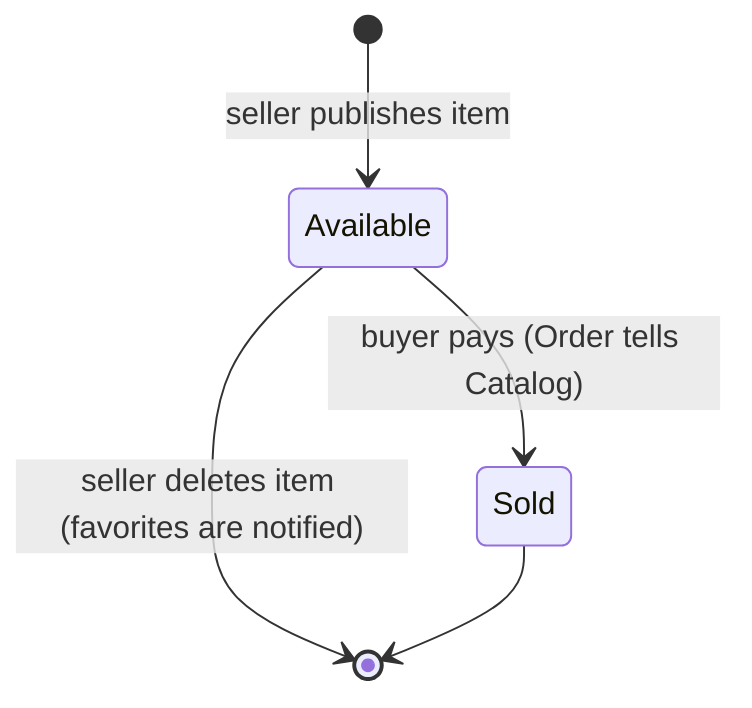
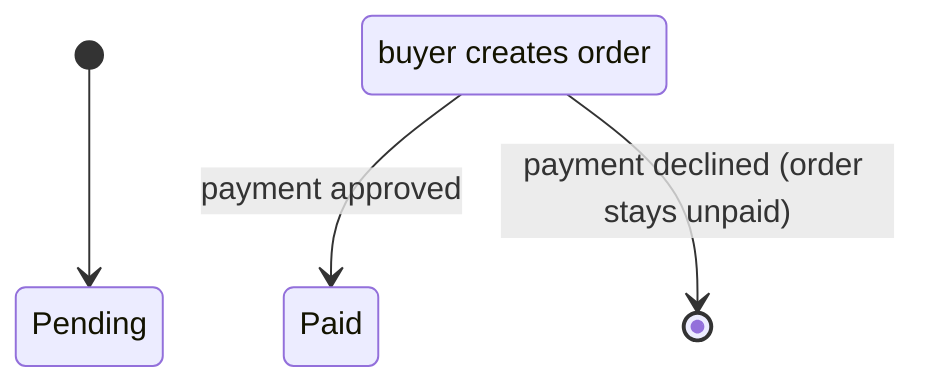

# Second-Hand Clothing App — Architecture

A seller publishes a second-hand clothing item, and a buyer browses the catalog, saves it as a favorite and buys it. The buyer pays with a 16-digit card number; once the payment is approved, the item becomes `Sold`, the order becomes `Paid`, and the seller plus everyone who had the item in favorites receives a notification instantly. One account can both buy and sell, and all notifications are stored so they are still there after switching accounts or reloading the page.

**Requirements covered:** 4 microservices, MongoDB, one real-time connection (Socket.IO), REST service-to-service calls, and one web client.

## The 4 services

| Service | Port | What it does | Its data (database.collection) |
|---|---|---|---|
| **Clothing Catalog** | 8001 | Publishes items, lists/searches the catalog, manages favorites, marks items as sold and deletes items (notifying favorite users) | `catalog_db.clothes` (id, name, price, description, seller, category, size, condition, status), `catalog_db.favorites` (user, item_id) |
| **Order** | 8002 | Creates orders, stores the purchase history, marks orders as paid, and **pushes the sale to the catalog and the notification service** | `order_db.orders` (id, item_id, item_name, item_price, quantity, buyer, seller, amount, status, paid, created_at) |
| **Payment** | 8003 | Validates the 16-digit card number, records the payment and tells the Order service to mark the order as paid | `payment_db.payments` (id, order_id, amount, paid, status, card_last4, created_at) |
| **Notification** | 8004 | Stores notifications in MongoDB, exposes the REST endpoints to list/delete them, and **runs the Socket.IO server that pushes events in real time** | `notification_db.notifications` (id, buyer, seller, item_id, item_name, event, amount, created_at) |

Each service is its own small FastAPI app with its own database, and they all run together with Docker Compose. Inside the containers every service listens on port `8000`; Compose maps them to `8001`–`8004` on the host. A service never reads another service's database — it asks that service over REST. There is also a **client** (`client/`) served by nginx on `8123` and a shared MongoDB container on `27017`.

## How they talk

- **The app calls the services over plain REST** (HTTP + JSON). The client fetches the catalog, favorites, orders and notifications directly from ports 8001–8004.
- **Order calls Catalog** to fill in the item name when the client did not send it, and to mark the item as `Sold` when the order is paid.
- **Payment calls Order** to read the amount if it was not supplied, then to mark the order as paid (`POST /orders/{id}/pay`). Only then does the Order service trigger the catalog and notification calls.
- **Catalog calls Notification** when a seller deletes an item (`POST /notifications/item-deleted`), sending the list of users who had it in favorites.
- **Notification calls Catalog** to find out which users favorited an item (`GET /favorites/item/{id}`) when an item is sold or deleted.
- **Best effort:** the follow-up calls (marking the item sold, pushing notifications) are wrapped in `try/except`. If a secondary service is unavailable, the purchase is still completed; these side effects are attempted but are not critical to the main flow.
- **Real time:** the Notification service also runs a Socket.IO server on the same port (8004). Each browser connection joins two rooms: `buyer-<user>` and `seller-<user>`, so the same account can receive both kinds of events.
  - when an item is sold, the browser rooms of the buyer, the seller and the favorite users get `item-sold`
  - when a seller deletes an item, the browser rooms of the users who favorited it get `item-deleted`



Solid arrows are REST calls; dotted arrows are the live Socket.IO connection.

## Item and order status

An item starts as `Available` and becomes `Sold` after an approved payment. A seller can also delete an item, which removes it and all its favorites.



An order only has two states: `Pending Payment` and `Paid`.



`Pending Payment` orders exist internally but are **hidden in the UI**: the purchase history only shows orders with `paid: true`. Being paid is tracked separately from the status (`paid: true`), and a declined payment leaves the order unpaid without marking the item as sold or sending notifications.

## API

### Clothing Catalog service
- `POST /clothes` with `{name, price, description?, seller?, category?, size?, condition?}` → 201 with the item (`status: Available`), price must be > 0
- `GET /clothes?status=Available&seller=bob&q=jacket` → items, newest first; filters optional (`q` searches by name, case-insensitive)
- `GET /clothes/{id}` → one item (404 if unknown)
- `PATCH /clothes/{id}` → update name, price, description, seller, category, size, condition or status
- `PATCH /clothes/{id}/status` with `{status}` → `Available` or `Sold` only, otherwise 400
- `POST /clothes/{id}/sold` → marks the item `Sold` (called by Order; `/purchase` and `/mark-sold` are aliases)
- `DELETE /clothes/{id}` → 204; deletes the item and its favorites and notifies favorite users
- `POST /favorites` with `{user, item_id}` → 201; accepts several field-name variants for compatibility
- `GET /favorites/{user}` → the items that user saved
- `DELETE /favorites/{user}/{item_id}` → 204
- `GET /favorites/item/{item_id}` → list of users who favorited that item (called by Notification)

### Order service
- `POST /orders` with `{item_id, item_name?, item_price?, buyer, seller, amount}` → 201 with the order (`status: Pending Payment`, `paid: false`)
- `GET /orders/buyer/{buyer_name}` → that buyer's orders, newest first (the UI keeps only paid ones)
- `GET /orders?buyer=&seller=&paid=&status=` → optional filters, newest first
- `GET /orders/{id}` → one order (404 if unknown)
- `POST /orders/{id}/pay` → marks the order `Paid`, then marks the item sold and sends the sale notification (called by Payment; `/mark-paid` and `/paid` are aliases)
- `PATCH /orders/{id}` with `{paid: true, status: "Paid"}` → same effect as paying
- `POST /orders/pay` with `{order_ids: [...]}` → pays several orders (called by Payment as a batch)

### Payment service
- `POST /payments` with `{orderId, amount?, card_number, cvv}` → 200 with the payment. The card number must be exactly 16 digits (validated in the client). A card ending in `0000` or a CVV of `000` simulates a declined payment. On approval, Payment calls Order to mark the order as paid.
- `GET /payments/{payment_id}` → one payment (404 if unknown)
- `GET /payments?order_id=...` → payments, newest first

### Notification service
- `POST /notifications/item-sold` → persists the sale notification and emits `item-sold` to the buyer, seller and favorite users (`/notifications`, `/notify`, `/sold` and `/item-sold` are aliases)
- `POST /notifications/item-deleted` → emits `item-deleted` to favorite users and persists the notification (`/notifications/item-removed` is an alias)
- `GET /notifications/user/{user}` → all notifications where the user is buyer or seller, newest first
- `GET /notifications/{user}?role=buyer|seller`, `GET /notifications/seller/{user}`, `GET /notifications` → alternative filtered listings
- `DELETE /notifications/{notification_id}` → delete one notification
- `DELETE /notifications/user/{user}` → clear all notifications for one user
- `GET /health` → `{"status": "ok"}`
- **Socket.IO events:** clients connect with query parameters `user` and `role`, then `join` a room (`buyer-<user>`, `seller-<user>`) or `register` with `{user, role}`. The server emits `item-sold` and `item-deleted`.

Every service also serves interactive docs at `/docs`.

## Main flow

The full step-by-step sequence is in [sequence-diagrams.md](sequence-diagrams.md).

1. A user opens `http://localhost:8123`, types their account name and publishes an item from the **Sell** tab (name, price, category, size, condition). The client calls `POST /clothes`.
2. Any user opens the **Catalog** tab: `GET /clothes?status=Available`, with optional search. Clicking the heart saves the item (`POST /favorites`); it turns red immediately and also appears in **Profile → Favorites** (`GET /favorites/{user}`).
3. The buyer clicks **Buy**, fills the checkout form with a 16-digit card number and confirms. The client calls `POST /orders` and then `POST /payments`.
4. Payment records the result. If approved, it calls `POST /orders/{id}/pay`.
5. Order marks itself `Paid`, calls Catalog to mark the item `Sold`, and calls Notification with the sale details.
6. Notification saves the records and pushes `item-sold` over Socket.IO to the buyer, the seller and the users who had the item in favorites. Their open tabs update instantly; notifications are also persisted for later.
7. The seller can delete one of their items from **Profile → My listings** (`DELETE /clothes/{id}`). Catalog removes the item and its favorites and calls Notification, which pushes `item-deleted` to the affected favorite users.
8. In **Profile**, the user sees their listings, sold items, favorites, paid purchase history and notifications. Individual notifications can be deleted, or all of them with **Clear all**.

## Stack

- Python 3.12 (`python:3.12-slim`) + FastAPI for each service (automatic Swagger docs at `/docs`)
- `pymongo` `AsyncMongoClient` for MongoDB, one database per service (`catalog_db`, `order_db`, `payment_db`, `notification_db`) in one MongoDB 7 container
- `httpx` for REST calls between services
- `python-socketio` in the Notification service, with rooms `buyer-<user>` and `seller-<user>`; the browser uses the standard Socket.IO client library
- Plain HTML + CSS + JavaScript client served by nginx (`nginx:alpine`) on port 8123, split into `index.html`, `style.css` and `script.js`
- Docker Compose to start MongoDB, the four services and the client with one command
- pytest, with respx to fake other services in tests

## Folder layout

```
Programming V/                  (repository root)
  README.md
  .gitignore
  docs/
    architecture.md
    sequence-diagrams.md
  project/                      (runnable application)
    docker-compose.yml
    client/
      index.html
      style.css
      script.js
    clothing-catalog-service/
    order-service/
    payment-service/
    notification-service/
```

The application is started from `project/` with `docker compose up --build`; the `docs/` folder and `README.md` are documentation only. Each service folder has the same shape: `app/main.py` (routes), `app/models.py` (Pydantic models), `app/db.py` (MongoDB connection and collections), `app/clients.py` (calls to other services, where needed), `app/sockets.py` (only in Notification), `tests/`, `requirements.txt` and a `Dockerfile`. The `client/` folder contains only static files, mounted read-only into nginx by `docker-compose.yml`.
