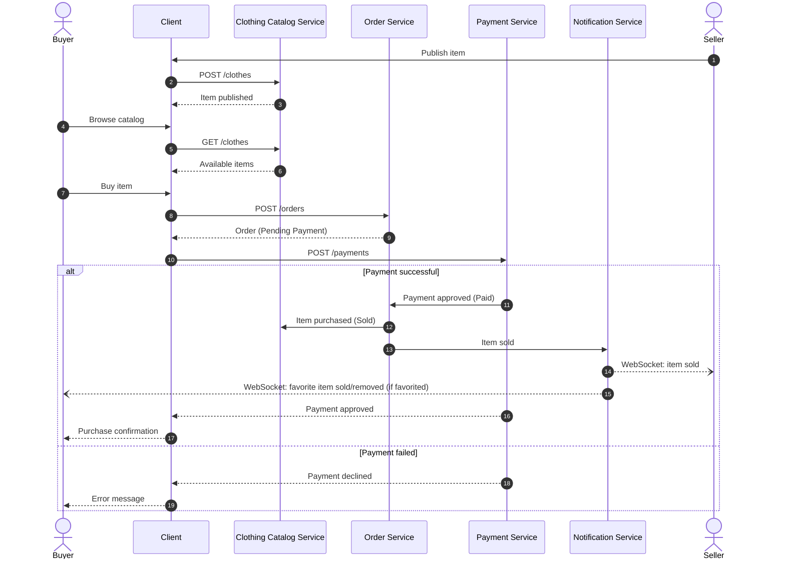
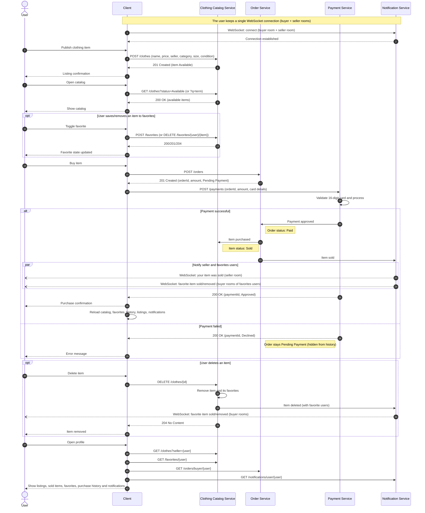

# Sequence Diagrams

This document describes the main workflow of the Second-Hand Clothing App, from a seller publishing a clothing item to a buyer purchasing it. The application consists of a **Client** and four microservices: **Clothing Catalog Service**, **Order Service**, **Payment Service** and **Notification Service** (WebSocket).

The **simple version** provides a high-level overview of the main flow (publish, buy, pay, notify) with the two actors (Buyer and Seller) and the essential steps, without going into technical details.

## Simple version

The **detailed version** adds, on top of those steps, the implementation details: the WebSocket connection (buyer/seller rooms), the exact publish fields (category, size, condition), search and favorite toggling, 16-digit card validation, the item deletion flow, profile loading (listings, sold items, favorites, history and notifications) and notifications to users who had the item in favorites. In short, the simple version is for understanding the business flow; the detailed version is for understanding how it runs technically.

## Detailed version

## Implementation notes

1. **Service-to-service calls are implemented**:
   - Payment Service → Order Service (mark order as paid).
   - Order Service → Clothing Catalog Service (mark item as sold).
   - Order Service → Notification Service (push "item sold").
   - Clothing Catalog Service → Notification Service (push "item deleted" to favorite users).
   - Notification Service → Clothing Catalog Service (fetch users who favorited an item).
2. **Real-time communication** uses Socket.IO with rooms `buyer-<user>` and `seller-<user>`. A single user connection joins both rooms.
3. **Failed payment**: a declined payment is returned as a normal result with status `Declined`; the order stays `Pending Payment`, no item is marked as sold and no notification is sent.
4. **Pending orders are not shown** in the purchase history; only paid orders are displayed.
5. **Notifications are persisted** in MongoDB and can be listed (`GET /notifications/user/{user}`) or deleted individually/all.
6. **Favorites** are managed in the Clothing Catalog Service and are shown inside the Profile tab. Favorite users are notified when their favorited item is sold or deleted.
7. **Item deletion** removes the item and its favorites, then notifies affected favorite users.