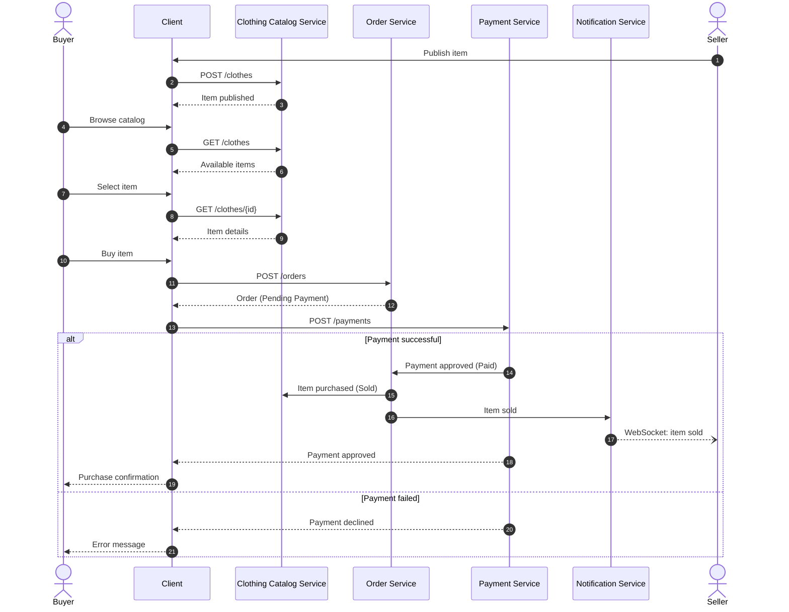
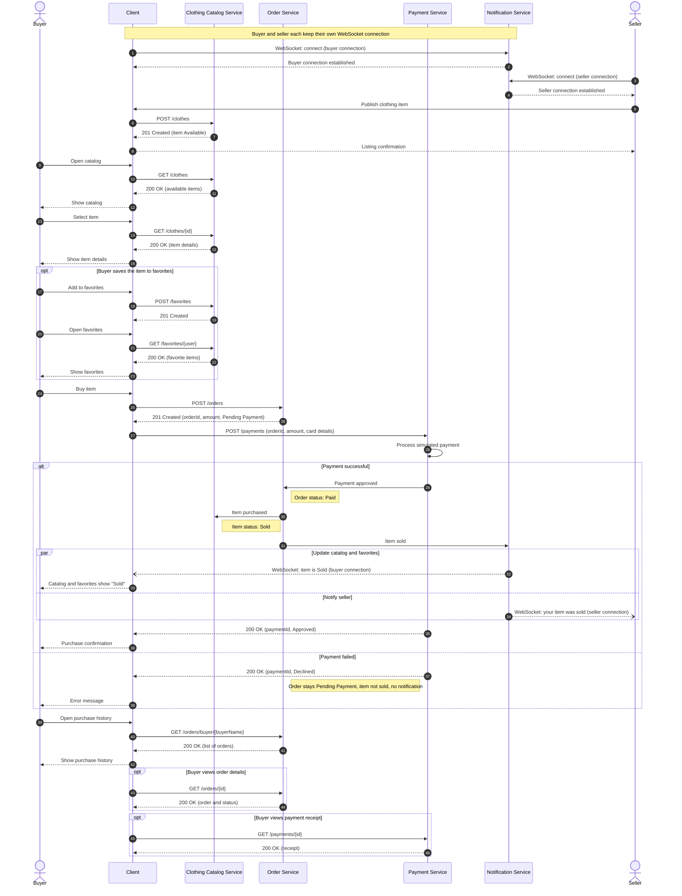

# Sequence Diagrams

This document describes the main workflow of the Second-Hand Clothing App, from a seller publishing a clothing item to a buyer purchasing it. The application consists of a **Client** and four microservices: **Clothing Catalog Service**, **Order Service**, **Payment Service** and **Notification Service** (WebSocket). The first diagram gives a simplified overview, and the second one shows the same workflow in detail, including all the endpoints of the system.

---

## Simple version

**Arrows used in the diagram**

| Arrow | Meaning |
|-------|---------|
| `->>` (solid) | HTTP request sent by the Client, a service-to-service call, or an action requested by a user |
| `-->>` (dashed) | HTTP response, or a message displayed to the user |
| `--)` (dashed, open head) | Real-time WebSocket message pushed by the Notification Service |

The steps *Payment approved (Paid)*, *Item purchased (Sold)* and *Item sold* are internal calls between the services, not public endpoints (see the implementation assumptions at the end of the document).

---

## Detailed version

**Arrows used in the diagram**

| Arrow | Meaning |
|-------|---------|
| `->>` (solid) | HTTP request from the Client to a microservice, a service-to-service call, or a user action |
| `-->>` (dashed) | HTTP response, or a message displayed to the user |
| `--)` (dashed, open head) | Real-time WebSocket message pushed by the Notification Service |

---

## Implementation assumptions

The following assumptions apply to both diagrams. No new public HTTP endpoints are introduced.

1. **Payment Service → Order Service:** after an approved payment, the Payment Service communicates directly with the Order Service. This is the intended architectural design and is not yet implemented. The Client is not responsible for updating the Order Service or the Clothing Catalog Service after payment.
2. **Internal mechanisms:** the current API specification does not define how the order status is set to *Paid*, how the item availability is set to *Sold*, or how the Notification Service is triggered. These are assumed to be internal service-to-service calls (Payment Service → Order Service → Clothing Catalog Service and Notification Service), not public endpoints. In the diagrams they are drawn as solid arrows with descriptive labels.
3. **Failed payment:** a declined payment is returned to the Client as a normal payment result with status *Declined*; the exact HTTP status code is an implementation detail. The order stays *Pending Payment*, no item is marked as sold and no notification is sent.
4. **Separate WebSocket connections:** the buyer and the seller each maintain their own independent WebSocket connection with the Notification Service, both opened before the purchase workflow and kept open during the session. The Notification Service identifies each user when the connection is opened. The seller's connection belongs to the seller's own Client, which is not drawn separately to keep the diagram readable.
5. **Order creation data:** the Client sends the item, buyer, seller and price in `POST /orders`, using the data it already loaded with `GET /clothes/{id}`.
6. **Subsequent GET requests:** the Client receives the order ID from the `POST /orders` response and the payment ID from the `POST /payments` response, and uses them for `GET /orders/{id}` and `GET /payments/{id}`.
